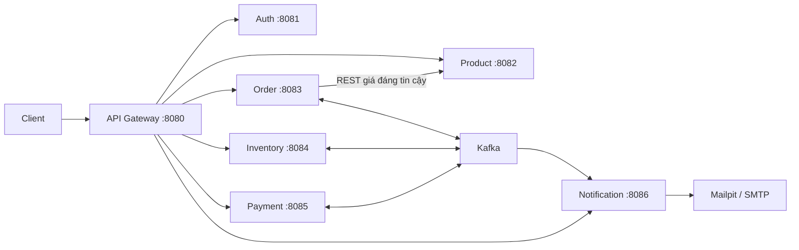
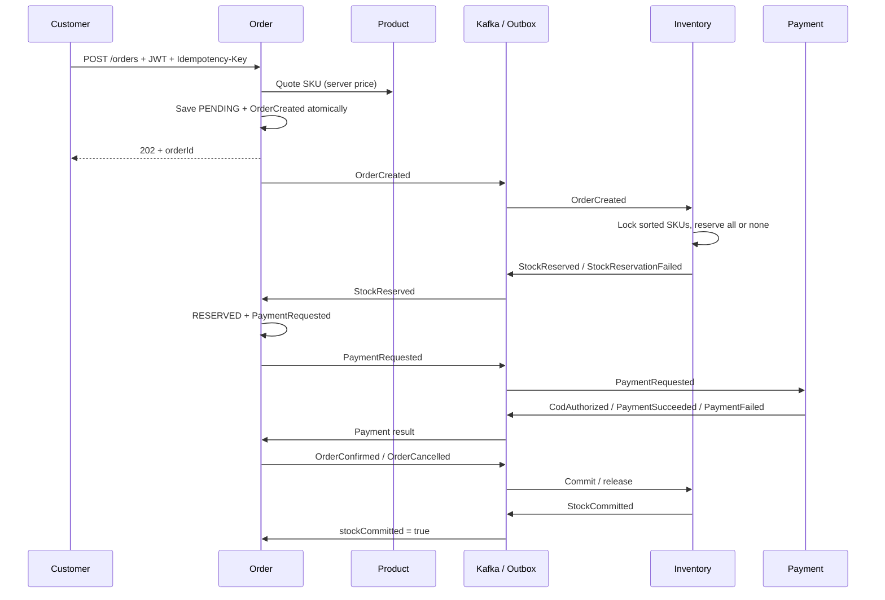

# Kiến trúc và Saga

Order Service chia domain, application, infrastructure và ports. Domain chứa trạng thái, snapshot hàng hóa, địa chỉ và quy tắc chuyển trạng thái. Những service còn lại giữ cấu trúc gọn theo bounded context.

Đây là Saga dùng sự kiện; Order Service quyết định chuyển trạng thái đơn và phát yêu cầu thanh toán sau khi giữ hàng thành công. Chính sách commit kho là lúc đơn được xác nhận, trước khi chuyển SHIPPING. API admin không cho giao hàng trước StockCommitted.

Kafka dùng một topic `shopzone.events`, 6 partition, key là orderId. Mọi sự kiện của một đơn đi cùng partition. Mỗi service có consumer group riêng. Listener dùng transaction database, ghi processed_events trước thay đổi nghiệp vụ trong cùng transaction; lỗi làm rollback cả hai.

Outbox mỗi database có sequence tăng dần. Publisher dùng advisory transaction lock để chỉ một worker của service phát tại một thời điểm, phát tuần tự và chờ broker acknowledgment. Khi crash sau gửi nhưng trước đánh dấu published, có thể phát lại cùng eventId. Consumer bỏ qua eventId đã xử lý. Consumer còn có kiểm tra trạng thái reservation/payment để chặn tác động lặp với eventId mới.

Consumer lỗi sẽ retry vô hạn với khoảng nghỉ 2 giây; không bỏ qua message nghiệp vụ. Poison message có thể chặn partition: vận hành cần kiểm tra log, sửa nguyên nhân/schema, rồi restart; chưa triển khai công cụ DLQ/replay. Không công khai Kafka ra Internet.

## Race conditions

- Customer hủy trước khi Inventory xử lý OrderCreated: reservation_batches lưu tombstone RELEASED; event tạo đến muộn không giữ kho.
- PaymentRequested đến sau OrderCancelled: payment_locks lưu cancelled và không khởi tạo giao dịch mới.
- Callback thành công đồng thời hủy: khóa order quyết định đơn đã PAID hay CANCELLED. Nếu CANCELLED, Payment Service hoặc RefundRequested thực hiện hoàn tiền mô phỏng idempotent.
- Hủy sau CONFIRMED/PAID: trả 409; không tự trả lại hàng đã bán.
- Kafka dừng: đơn/sự kiện vẫn ở database, outbox phát lại khi Kafka phục hồi. Timeout cũng phát qua outbox nên việc hoàn kho có thể trễ khi hạ tầng lỗi.

## Vận hành local

Chỉ Gateway được publish cổng ứng dụng mặc định. Mỗi service vẫn tự xác minh JWT nên việc debug trực tiếp không bỏ qua phân quyền. Không tin cậy header tự khai báo customerId/role. Rate limiter trong Gateway là in-memory cho một instance; muốn scale nhiều instance cần quota chia sẻ hoặc gateway bên ngoài.

Readiness endpoint thể hiện tiến trình đã khởi động. Kiểm tra `/actuator/health` của từng service để xem database/SMTP; theo dõi log Kafka/outbox để biết tình trạng Saga. Chưa đưa ra số đo p95 dưới 500ms hoặc cam kết tải vì chưa benchmark.
